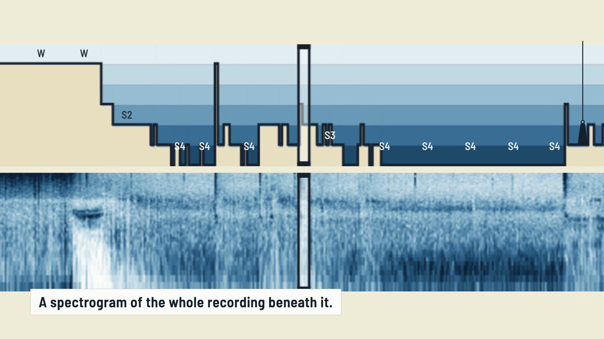
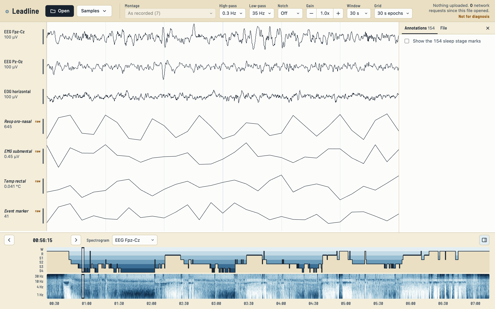

# Leadline

[](https://github.com/draarivpatel-ui/leadline/releases/download/v0.1.0/leadline-launch-film-1920x1080.mp4)

[Watch the launch film](https://github.com/draarivpatel-ui/leadline/releases/download/v0.1.0/leadline-launch-film-1920x1080.mp4) (42 s, 1920 x 1080, MP4) · [Try it in your browser](https://aariv.me/leadline/) · [Release v0.1.0](https://github.com/draarivpatel-ui/leadline/releases/tag/v0.1.0)



## What it does

Leadline is a viewer for EEG and sleep recordings in EDF, EDF+ and BDF that runs entirely in the browser. The file is
read on your computer by a Web Worker and is never uploaded. A lead line is the weighted line sailors dropped to take
a sounding; in EEG, a lead is also a channel. The viewer draws a night's sleep as a depth chart.

- Opens EDF, EDF+ (continuous and discontinuous), BDF and BDF+, including annotation-only EDF+ files such as a
  separately scored hypnogram, which are aligned to the recording by their start times.
- Draws every channel with min/max decimation, so a one-sample spike stays visible at any zoom. 5 s to 5 min
  windows, gain, a 1 s or 30 s epoch grid, drag or arrow keys to scroll.
- High-pass, low-pass and 50/60 Hz notch filters, all zero phase, matching SciPy (`sosfiltfilt`, `filtfilt`).
  They apply to EEG only: respiration, temperature, event, EMG, ECG and other slow or non-voltage channels are
  drawn as recorded, EOG keeps a high-pass of at most 0.3 Hz, and a row drawn without some filter is tagged on
  its label. Sleep recordings open at 0.3 to 35 Hz, other EEG at 1 to 70 Hz.
- Montages: as recorded, bipolar double banana, average reference, built from the electrode labels. Electrodes
  on different references are never subtracted from each other, and the page says what was left out.
- Annotations as magenta marks and a list; sleep stages as a depth profile of the whole night that doubles as the
  navigator (deep sleep is literally deep).
- A spectrogram of any channel across the whole recording, on a log frequency axis, shown relative to each
  frequency's median so changes over the night stand out.
- Opens a recording cut short (a crash, a full disk) as its complete records when asked.
- Counts network requests after a file opens and shows the number, so "nothing uploaded" can be checked.

Two open recordings are bundled (see [DATA.md](DATA.md)): a 6.8 hour Sleep-EDF night with its technician-scored
hypnogram, and a 64-channel motor imagery run from PhysioNet.

## Use it

Open [aariv.me/leadline](https://aariv.me/leadline/) and pick **Samples**, or run it yourself:

```sh
git clone https://github.com/draarivpatel-ui/leadline.git
cd leadline
npm install
npm run dev        # http://localhost:5173
npm run build      # static site in dist/, works from any sub-path
```

Open a file with **Open** or drop it on the page. To add a hypnogram, select the recording and its
`*-Hypnogram.edf` together.

Keyboard: left and right arrows page by one window (Shift for a fifth), Home and End, `+` and `-` for gain.
The depth profile is a slider: click or drag it, or focus it and use the arrow keys.

## How it works

```
File (Blob) --slice--> Web Worker ----------------------------> page
                       src/core/edf      header, TALs, record times, Blob-slice reads with a block cache
                       src/core/montage  derivations from electrode labels
                       src/core/dsp      Butterworth and notch (zero phase), min/max decimation, FFT, PSD
                       src/core/engine   readWindow, spectrogram, hypnogram, annotations
                                                                  src/app  canvas traces, depth profile,
                                                                           spectrogram, controls
```

- **Reading.** Only the byte range a window needs is read (`Blob.slice`), so a large file never sits in memory.
  Physical values use EDFlib's arithmetic order and match pyEDFlib bit for bit.
- **Windowed filtering.** A margin is read on each side of the window, sized from the filter's pole radii so the
  response has decayed to 1e-6, then discarded. The result matches filtering the whole recording. Filters run on
  each gap-free stretch of an EDF+D file separately.
- **The engine API** (`src/core/index.ts`) is plain async methods on transferable data. It runs as is in Node
  (the tests use it there) or in a Worker through `createEngineClient`.

The full specification, with the primary sources and how other readers behave, is in [SPEC.md](SPEC.md).

## Tested against

| What | Against | Result |
| --- | --- | --- |
| Digital and physical samples, 11 files (EDF, EDF+, BDF, BDF+) | pyEDFlib 0.1.42 | SHA-256 of every signal's full arrays identical |
| Physical samples | MNE-Python 1.8.0 | within 1e-9 relative |
| Discontinuous EDF+D and BDF+D (pyEDFlib refuses them) | independent Python writer and edfcore 0.6 | record times, segments, annotations and samples equal |
| 12 malformed or truncated files | expected error codes | each fails cleanly or opens with a warning |
| Butterworth, notch, filter chain, spectrogram | SciPy 1.13.1 | within 1e-9 relative |
| The engine in Chrome through a Vite harness | 10 checks | includes zero requests to any other origin |
| The built app in headless Chrome | 35 checks | includes zero requests to any other origin |

```sh
sh scripts/fetch-test-data.sh                  # PhysioNet and third-party test files, SHA-256 pinned
python3 -m venv .scratch/venv && .scratch/venv/bin/pip install -r scripts/golden/requirements.txt
sh scripts/golden/run.sh                       # reference values from pyEDFlib, MNE and SciPy
npx vitest run                                 # 92 tests
node tests/browser/run-harness.mjs             # 10 checks in Chrome
npm run build && node tests/browser/app-e2e.mjs   # 35 checks on the built app
```

Measured on an Apple silicon Mac: a 30 s window of 64 channels with all three filters takes about 13 ms in the
engine and about 26 to 33 ms from request to drawn frame in Chrome.

## Limits

- Reads only; it does not write or edit EDF files.
- Channel types are read from labels, units and rates (EDF+ standard texts). A non-EEG channel with an EEG-like
  label, unit and rate is filtered as EEG.
- The BioSemi Status channel is drawn as a number, not decoded into triggers.
- Annotations are recognised only in EDF+ and BDF+ files, as the standard defines them.
- The spectrogram is a Hann-window periodogram averaged into columns; there is no multitaper option.

## Disclaimer

Leadline is for research and learning. **It is not a medical device and not for diagnosis.** Do not use it to make
clinical decisions.

## Licence

MIT, see [LICENSE](LICENSE). The Sounding typeface is under the SIL Open Font License 1.1 (`fonts/OFL.txt`).

## Credits

Third-party pieces are listed in [THIRD_PARTY.md](THIRD_PARTY.md):

- The interface typeface, Sounding (`fonts/`, OFL 1.1), is a modified version of Barlow Semi Condensed by the
  Barlow Project Authors.
- Bundled recordings: PhysioNet Sleep-EDF Expanded (Kemp et al.) and EEG Motor Movement/Imagery (Schalk), both
  ODC-By 1.0, with attribution in [DATA.md](DATA.md).
- The EDF and EDF+ specifications by Bob Kemp and colleagues (edfplus.info), the BioSemi BDF description and the
  BDF+ description by Teunis van Beelen.
